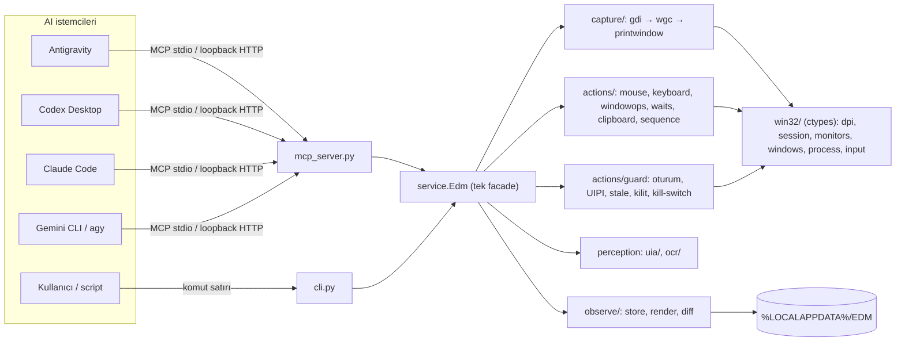

# EDM — Everything Desktop on Me · Tasarım Belgesi (v0.1)

> Durum: **Onaylı tasarım, uygulama başlamadı.** Uygulama planı: [01-UYGULAMA-PLANI.md](01-UYGULAMA-PLANI.md). Çalışma protokolü: [../../AGENTS.md](../../AGENTS.md).
> Tarih: 2026-11-18 · Sahip: Hüseyin Günaydın (`smitelagwar`)

## 1. Amaç ve neden

Yapay zekâ ajanları (Antigravity, Codex Desktop, Claude Code, Gemini CLI/`agy`) AutoCAD, WinRAR, Chrome, AOC G-Menu gibi masaüstü programlarında iş yaparken **ekranı göremiyor**. Pencereye bağlanmaya çalışıyor, bağlanamıyor, tekrar deniyor. Kullanıcı aynı denemeleri tekrar tekrar onaylamak zorunda kalıyor.

EDM, ajana **tek, güvenilir ve yüksek çözünürlüklü bir "göz ve el" katmanı** verir:

- **Göz:** O anda ekranda gerçekte ne varsa (menüler, sağ tık listeleri, tepsi simgeleri, modal diyaloglar, DirectX/OpenGL çizim alanları) tam ekran, monitör, pencere veya dikdörtgen bölge olarak **fiziksel piksel çözünürlüğünde** alır. Ayrıca **büyütme (zoom)**, **ızgara**, **UI öğesi numaraları (Set-of-Mark)** ve **OCR ile metin bulma** sunar.
- **El:** Fare (tek/çift/sağ/orta tık, sürükleme, tekerlek), klavye (kısayollar, Unicode metin), pencere yönetimi, uygulama başlatma, pano ve sıralı eylemler.
- **Kapalı döngü:** Her eylemden sonra ekranın durulmasını bekler ve yeni gözlemi aynı yanıtta döndürür. Ajan körlemesine tekrar denemez, sonucu görür.

### 1.1 Kök neden bulguları (2026-11-18, bu bilgisayarda ölçüldü)

| Bulgu | Etki | EDM'nin cevabı |
|---|---|---|
| Antigravity komut ortamı `WinSta0\exebox-…` adlı **izole masaüstünde** çalışıyor, kullanıcının `Default` masaüstünde değil | Ajanın açtığı program ve aldığı görüntü kullanıcının ekranında değil, boş bir masaüstünde kalıyor. Sonsuz deneme bu yüzden oluyor | `doctor` bunu ilk çağrıda tespit eder ve `ISOLATED_DESKTOP` hatasını **yeniden denenmez** olarak döndürür. EDM, kullanıcının oturumunda çalışacak şekilde MCP sunucusu olarak kaydedilir. Masaüstü değiştirme/atlatma **yapılmaz** |
| Pencere tabanlı yakalama (WGC/Sky) `FrameArrived timed out` verdi (ideCAD, 2026-11-08) | Pencereye bağlanma kırılgan | Varsayılan yol **ekran seviyesinde GDI yakalama** (PrtSc mantığı). Pencere görüntüsü ekrandan kırpılır. WGC ve PrintWindow yalnızca pencere örtülüyse yedek yol olarak kullanılır |
| Yönetici yetkili pencereler (ör. G-Menu) normal süreçten gelen girdiyi sessizce yutar (UIPI) | "Tıkladım" sanılır ama hiçbir şey olmaz | Eylemden önce hedef sürecin bütünlük düzeyi kontrol edilir ve `ELEVATION_REQUIRED` döner |
| Ekran ölçekleme (%125/%150) koordinatları kaydırır | Yanlış yere tıklama | Süreç Per-Monitor-V2 DPI farkındalığıyla başlar. Tüm iç koordinatlar fiziksel pikseldir. Ajanın gördüğü önizleme koordinatlarını ekrana EDM çevirir |
| Bu makine: Windows 10 22H2 (19045), tek monitör 2560×1440, RTX 4060 + AMD iGPU (hibrit), Python 3.14.3 + uv 0.12.5, `gh` oturumu açık | DXGI Desktop Duplication hibrit GPU'da `DXGI_ERROR_UNSUPPORTED` verebilir. Win10'da WGC sarı çerçevesi kapatılamaz | DXGI v0.1 kapsamı dışında. WGC yalnızca yedek yol |

## 2. Hedefler, hedef dışı, anti-hedefler

### Hedefler (v0.1)
- **G1** `doctor`: oturum, masaüstü, DPI, monitörler, yetki ve arka uç durumunu tek çağrıda raporlar.
- **G2** Yakalama: `screen`, `monitor:N`, `window:<sorgu>`, `region:x,y,w,h` ile fiziksel çözünürlükte, orijinal PNG diske, önizleme ajana.
- **G3** `zoom`: Var olan bir gözlemin herhangi bir dikdörtgenini orijinal çözünürlükten (gerekirse 4×'e kadar büyüterek) verir. İsteğe bağlı olarak o bölgeyi taze yakalar.
- **G4** Koordinat sözleşmesi: Ajan, gördüğü görüntünün pikseliyle (veya `norm1000`) konuşur. Ekrana çeviriyi EDM yapar.
- **G5** Girdi: tıklama, sürükleme, tekerlek, kısayol, Unicode metin, pencere işlemleri, başlatma, pano.
- **G6** Güvenli eylem: oturum ve güvenli masaüstü kontrolü, UIPI tespiti, eski gözlem (stale) koruması, ajanlar arası girdi kilidi, acil durdurma.
- **G7** Algı: UIA öğeleri + numaralı işaretler, Windows OCR ile metin bulma (Türkçe dahil), görüntü farkı, bekleme koşulları.
- **G8** Kullanıcı alıntısı: Kullanıcı dikdörtgeni kendi çizer (`edm snip`) ve ajan bunu okur.
- **G9** Arayüzler: Tek çekirdek, iki kabuk: **MCP sunucusu** (stdio + kullanıcının başlattığı loopback HTTP) ve **CLI**.
- **G10** Ajan becerisi: Her istemci için kurulum belgesi ve döngü önleyici `SKILL.md`.

### Hedef dışı (v0.1'de yapılmayacak, [IDEAS.md](IDEAS.md)'ye yazılır)
DXGI arka ucu · OmniParser/yerel VLM ile görsel öğe tespiti · makro kaydet/oynat · video/GIF kaydı · sistem tepsisi uygulaması · uzak makine kontrolü · macOS/Linux · Chrome DOM köprüsü (Chrome DevTools MCP zaten var).

### Anti-hedefler (çalışsa bile başarısızlık sayılır)
- Sessizce yanlış yere tıklamak. Doğrulanamayan eylem hata döndürmelidir.
- Ekran görüntülerini veya eylem günlüklerini Git'e işlemek. Bunlar kişisel veridir.
- Ajanı döngüye sokan belirsiz hatalar. Her hata `retryable` ve `next_step` taşır.
- Asılı kalan çağrı. Her işlemin üst zaman sınırı vardır.
- Güvenlik sınırı atlatmak: masaüstü değiştirme, UAC atlatma, uiAccess imza hilesi, sandbox/host yaması.
- Kullanıcının panosunu veya pencerelerini testlerde kalıcı olarak bozmak.

## 3. Kısıtlar
- Windows 10 1903+ ve Windows 11. Bu makine 19045'tir. `sys.platform != "win32"` ise temiz hata verilir.
- Python **3.12** (uv yönetir). Neden: winrt/windows-capture/mcp tekerleklerinin en geniş desteği. `requires-python = ">=3.12,<3.14"`.
- Yönetici yetkisi gerekmez. Yönetici penceresi için kullanıcı EDM'yi kendisi yönetici olarak başlatır.
- Ağ yok. Telemetri yok. Tek istisna kullanıcının başlattığı `127.0.0.1` HTTP modudur.
- Bağımlılıklar MIT/BSD/Apache uyumlu olmalıdır. İzin listesi [AGENTS.md](../../AGENTS.md) §7'dedir.

## 4. Yaklaşımlar

| Yaklaşım | Artı | Eksi | Karar |
|---|---|---|---|
| A. Windows-MCP'yi fork edip özelleştirmek | Hızlı başlangıç | Kod tabanı bizim değil, UIA ağırlıklı. Koordinat ve stale sözleşmemizi sonradan eklemek zor. Lisans/yön bağımlılığı | ✗ (yalnız fikir kaynağı) |
| **B. Kendi Python çekirdeğimiz (ctypes Win32) + MCP + CLI** | Tam kontrol, `desktop.py` deneyimiyle uyumlu, test edilebilir saf katmanlar, hızlı iterasyon | Performans C#/Rust kadar değil (bu kullanım için yeterli) | **✓ Seçildi** |
| C. Rust/C# yerel servis | En hızlı, tek exe | Geliştirme ve test maliyeti yüksek, ajanla uygulama riski yüksek | ✗ (ileride sıcak yollar için) |

## 5. Mimari



**Akış (tek eylem):** `screenshot` → ajan görüntüyü okur → `click(observation_id, x, y)` → guard kontrolleri → girdi → ekran durulana kadar bekleme (≤3 s) → yeni gözlem → yanıt.

## 6. Koordinat sözleşmesi (en kritik bölüm)

1. İç koordinat uzayı: **sanal ekranın fiziksel pikselleri**. Çoklu monitörde negatif değer olabilir.
2. Her yakalama bir **Observation** üretir: `id`, `frame_rect` (yakalanan bölgenin ekran dikdörtgeni), orijinal PNG yolu, önizleme boyutu, `ImageMapping`.
3. Ajan koordinatı her zaman **bir gözleme bağlı** verir: `observation_id + x + y + coord_space`.
   - `coord_space="pixel"` (varsayılan): ajanın gördüğü önizleme görüntüsünün pikseli.
   - `coord_space="norm1000"`: 0–1000 normalize değerler (Gemini'nin `box_2d` alışkanlığı). `(0,0)` sol üst, `(1000,1000)` sağ alt.
4. Çeviri: `screen = frame_rect.origin + crop.origin + img_xy × (crop.size / img.size)`. Yuvarlama, hedef pikselin merkezine yarım-yukarı yapılır.
5. `zoom` sonucu yeni bir **alt gözlemdir** (`parent_id`). Koordinatları kendi görüntüsüne göredir ve zincirleme zoom doğru eşlenir.
6. Mutlak ekran koordinatı (`screen_x/screen_y`) yalnız açık parametreyle kabul edilir ve yanıtta uyarı üretir.
7. **Stale koruması:** Pencere hedefli gözlemde pencere taşınmış, kapanmış, başlığı değişmiş veya üstte modal açılmışsa `STALE_OBSERVATION` döner ve girdi gönderilmez. `verify=true` (varsayılan) iken hedef noktanın çevresindeki 24×24 px yama, eylemden hemen önce taze yakalanır. Fark eşiği 0,15'i aşarsa yine `STALE_OBSERVATION` döner. Gözlem ömrü varsayılan 120 s'dir.

## 7. Yakalama stratejisi

| Hedef | Birincil | Yedek 1 | Yedek 2 | Not |
|---|---|---|---|---|
| `screen` / `monitor:N` / `region` | GDI (`mss`) | — | — | DWM bileşik çıktısı: DirectX/OpenGL pencereleri, menüler ve katmanlı pencereler dahildir |
| `window:<sorgu>` görünür (örtülme payı ≥ %98) | GDI ekran kırpma (`DWMWA_EXTENDED_FRAME_BOUNDS`) | WGC | PrintWindow (`PW_RENDERFULLCONTENT`) | Görünür pencerede ekran neyse odur |
| `window` örtülü | WGC tek kare (3 s zaman aşımı) | PrintWindow | — | Win10'da sarı çerçeve kısa süre görünebilir (belgelenir) |
| `window` simge durumunda | — | — | — | `WINDOW_MINIMIZED`. `restore=true` ise önce geri yüklenir |

- **Boş kare tespiti:** Pillow `ImageStat` ile tüm kanallarda std < 2,0 ve uç değer aralığı < 8 ise kare "boş" sayılır. Pencere hedefinde sıradaki yedeğe geçilir. Hepsi boşsa `CAPTURE_BLANK` döner ve `attempts` listesi eklenir.
- **İmleç:** GDI imleci yakalamaz. `cursor=true` iken imleç konumu önizlemeye kırmızı artı olarak çizilir. Orijinal PNG temiz kalır.
- **Önizleme:** Uzun kenar varsayılan 1600 px'tir. Küçültme Lanczos ile yapılır, büyütme yapılmaz. Yük sınırı 1,5 MB'tır: önce PNG denenir, aşarsa JPEG kalitesi 85→60 basamaklarla düşürülür.
- **Izgara (`grid=true`):** Önizlemenin kenarlarına her 100 önizleme pikselinde bir etiketli çentik çizilir. Boyut değişmez.
- **Görünmeyenler (bilinen sınırlar):** UAC/kilit ekranı (güvenli masaüstü), DRM korumalı video, `WDA_EXCLUDEFROMCAPTURE` kullanan pencereler. EDM bunları "göremediğini" açıkça söyler.

## 8. Eylem güvenliği (her girdiden önce `guard.preflight`)

1. Oturum `ok` mi? Değilse `ISOLATED_DESKTOP`, `SECURE_DESKTOP` veya `SESSION_LOCKED` döner.
2. Acil durdurma tetiklendi mi? (`Ctrl+Alt+Shift+F12` ya da imleç birincil monitörün (0,0) köşesinde.) Tetiklendiyse `ABORTED_BY_USER` döner.
3. Noktanın altındaki pencerenin süreci bizden yüksek bütünlükte mi? Öyleyse `ELEVATION_REQUIRED` döner.
4. Gözlem taze mi, hedef değişmedi mi? Değiştiyse `STALE_OBSERVATION` döner.
5. Girdi kilidi `Local\EDM_INPUT_LOCK` (10 s) alınamazsa `BUSY` döner. Bu, birden fazla ajanın aynı anda tıklamasını önler.
6. `SendInput` gönderilen olay sayısını eksik döndürürse `INPUT_BLOCKED` döner.

Kullanıcı kararı: **tam kontrol, onay kapısı yok.** Acil durdurma bir kısıtlama değil, kullanıcının kendi elindeki fren. `config.toml` ile kapatılabilir.

## 9. Gözlem deposu ve gizlilik
- Kök: `%LOCALAPPDATA%\EDM\`. Altında `observations\YYYY-MM-DD\<id>.png` (orijinal) + `<id>.preview.(png|jpg)`, `index.jsonl` ve `logs\actions-YYYY-MM-DD.jsonl` bulunur.
- Saklama süresi 7 gün **veya** 2 GB'tır (önce dolan). Budama her 50 yakalamada bir ve `edm prune` ile yapılır.
- Disk tabanlı indeks sayesinde CLI süreçleri ile MCP sunucusu aynı gözlem kimliklerini çözebilir.
- Hiçbir veri ağa gitmez. Görüntüler yalnızca kullanıcının kullandığı AI istemcisine araç sonucu olarak verilir. README'de parola ve kişisel veri uyarısı bulunur.

## 10. Arayüz sözleşmesi

### 10.1 Yanıt zarfı (MCP: `TextContent` içinde JSON + varsa `ImageContent` · CLI: stdout JSON)
```json
{"ok": true, "action": "click",
 "observation": {"id": "o-20261118-174201-0007", "target": "window:acad", "image_size": [1600, 900],
                 "frame_rect": [0, 0, 2560, 1440], "scale": 0.625, "backend": "gdi",
                 "path": "C:/Users/.../o-...png", "parent_id": null},
 "details": {}, "warnings": []}
```
```json
{"ok": false, "error": {"code": "STALE_OBSERVATION", "message": "Window moved since observation",
 "retryable": true, "next_step": "Call screenshot again and use the new observation_id"}}
```

### 10.2 MCP araçları (sunucu adı `edm`, araç adları sabittir)
Adresleme modlarından **tam olarak biri** verilir: (`observation_id`+`x`+`y`[+`coord_space`]) | (`observation_id`+`mark`) | `text` (+`target`) | (`screen_x`+`screen_y`).

| Araç | Parametreler (varsayılan) | Döner |
|---|---|---|
| `doctor` | — | ortam raporu |
| `list_monitors` | — | monitör listesi |
| `list_windows` | `query=None`, `include_minimized=true` | pencere listesi |
| `screenshot` | `target="screen"`, `max_edge=1600`, `grid=false`, `cursor=true`, `marks=false`, `restore=false` | gözlem + görüntü |
| `zoom` | `observation_id`, `x`,`y`,`w`,`h`, `coord_space="pixel"`, `fresh=false`, `factor=None` | alt gözlem + görüntü |
| `ui_elements` | `window=None` (ön plan), `max_elements=150` | öğeler + işaretli gözlem |
| `find_text` | `query`, `target="screen"`, `match="contains"` | eşleşmeler + gözlem |
| `click` | adresleme + `button="left"`, `count=1`, `modifiers=[]`, `verify=true`, `observe=true` | sonuç + yeni gözlem |
| `move_mouse` | adresleme | sonuç + yeni gözlem |
| `drag` | `from_*` ve `to_*` adresleme, `button="left"`, `duration_ms=300` | sonuç + yeni gözlem |
| `scroll` | adresleme + `dy=0` (çentik, + yukarı), `dx=0` | sonuç + yeni gözlem |
| `type_text` | `text`, `interval_ms=0`, `observe=true` | sonuç + yeni gözlem |
| `press_keys` | `keys` (ör. `"ctrl+s"` veya `["alt","f","o"]`), `repeat=1` | sonuç + yeni gözlem |
| `window_action` | `window`, `action` ∈ {focus, minimize, maximize, restore, close, move, resize}, `rect=None` | sonuç + yeni gözlem |
| `launch` | `target` (yol, uygulama adı, AUMID, URL), `args=[]`, `wait_window=None` (regex), `timeout_s=30` | pencere bilgisi + gözlem |
| `wait_for` | `kind` ∈ {change, stable, window, window_gone, text}, `target`, `query`, `timeout_s=10` (≤60) | sonuç + gözlem |
| `clipboard` | `op` ∈ {get, set}, `text=None` | metin / görüntü |
| `run_sequence` | `steps` (≤25, yalnız eylem araçları + `wait_for`), `stop_on_error=true` | adım sonuçları + son gözlem |
| `request_user_region` | `prompt=None`, `timeout_s=120` | kullanıcının çizdiği bölge gözlemi |
| `get_user_snips` | `limit=1` | son kullanıcı alıntıları |

`window` sorgu dilbilgisi şöyledir: `hwnd:1234` · `pid:5678` · `exe:acad.exe` · `class:…` · `title:…` · `re:<regex>` · düz metin (büyük/küçük harf duyarsız başlık içerir). Birden fazla eşleşme varsa Z-sırasında en üstteki seçilir ve diğerleri `warnings.alternatives` içinde listelenir.

### 10.3 Hata kodları

| Kod | retryable | next_step (özet) |
|---|---|---|
| `ISOLATED_DESKTOP` | hayır | EDM etkileşimli masaüstünde değil. Kullanıcıya bildir. MCP kaydı veya `edm serve-http`. Tekrar deneme |
| `SECURE_DESKTOP` / `SESSION_LOCKED` | kullanıcı sonrası | UAC/kilit ekranı açık. Kullanıcıdan iste, `wait_for stable` |
| `ELEVATION_REQUIRED` | hayır | Hedef yönetici yetkili. Kullanıcı EDM'yi yönetici başlatmalı |
| `WINDOW_NOT_FOUND` | evet | `list_windows` veya `launch` |
| `WINDOW_MINIMIZED` | evet | `window_action restore` veya `restore=true` |
| `STALE_OBSERVATION` / `OBSERVATION_NOT_FOUND` | evet | Yeni `screenshot` al |
| `POINT_OUT_OF_BOUNDS` | evet | Koordinatı gözlem görüntüsü içinde ver |
| `CAPTURE_FAILED` / `CAPTURE_BLANK` | bir kez | `target="screen"` dene. Pencereyi `focus` et |
| `INPUT_BLOCKED` | hayır | UIPI veya güvenlik yazılımı. Kullanıcıya bildir |
| `ABORTED_BY_USER` | hayır | Dur ve kullanıcıya sor |
| `BUSY` | evet | 1–2 s bekle, tekrar dene (en fazla 3) |
| `TIMEOUT` | bir kez | Koşulu veya süreyi gözden geçir |
| `UIA_UNAVAILABLE` / `UIA_TIMEOUT` | hayır | OCR veya görsel koordinat kullan |
| `DEPENDENCY_MISSING` | hayır | Mesajdaki kurulum adımını kullanıcıya ilet |
| `INVALID_ARGUMENT` | evet | Parametreyi düzelt |
| `INTERNAL` | hayır | Günlük yolunu kullanıcıya ilet |

### 10.4 CLI
`edm doctor | monitors | windows | shot | zoom | elements | find-text | click | move | drag | scroll | type | keys | window | launch | wait | clip | seq | snip | prune | mcp | serve-http | --version`. Çıktı stdout'a JSON olarak yazılır. Çıkış kodları: 0 başarı, 2 `EdmError`, 1 beklenmeyen hata. Bekçi zamanlayıcısı 90 s'dir.

## 11. Ajan kullanım stratejisi (beceri dosyasına girer)
1. Oturum başında bir kez `doctor` çağrılır. `ISOLATED_DESKTOP` gelirse durulur ve bildirilir.
2. Görsel olmayan yol önce gelir: uygulamanın CLI'si (`rar.exe`), klavye kısayolu, AutoCAD komut satırı, Chrome için DOM araçları.
3. Sonra UIA: `ui_elements` → `click(mark=…)`.
4. Sonra OCR: `click(text="Tamam")`.
5. Son olarak görsel koordinat: `screenshot` → küçük hedefte `zoom` → `click(observation_id, x, y)`.
6. Her eylemden sonra dönen gözlem okunur ve etki doğrulanır.
7. **Döngü freni:** Aynı adım aynı yöntemle en fazla 2 kez denenir. Sonra yöntem değiştirilir. 3 farklı yöntem başarısızsa durulur ve son gözlem yoluyla rapor verilir. `retryable=false` hatalar asla tekrarlanmaz.

## 12. Kararlar
**Kullanıcı kararları (2026-11-18):**
- Tüm istemciler desteklenir: Antigravity, Codex Desktop, Claude Code, Gemini CLI/agy ve scriptler.
- **Tam kontrol**, onay kapısı yok.
- Yönetici programları tespit edilir ve açıkça raporlanır. Kullanıcı isterse EDM'yi UAC onayıyla yönetici başlatır. UAC atlatma yoktur.
- README İngilizce + `README.tr.md` Türkçe. Plan ve ajan belgeleri Türkçe.
- Lisans MIT. Repo public: `smitelagwar/EDM`.

**Tasarımcının kararları (itiraz edilebilir):** Python 3.12 + ctypes · GDI birincil · WGC/PrintWindow yedek · DXGI ertelendi · gözlem tabanlı koordinat sözleşmesi + `norm1000` · acil durdurma varsayılan açık · loopback HTTP modunu yalnız kullanıcı başlatır · Windows OCR (çevrimdışı) · `uiautomation` paketi. Ayrıntılar [DECISIONS.md](DECISIONS.md)'dedir.

## 13. Sürümleme
- `v0.1.0-rc1`: Tüm fazlar tamam, birim/entegrasyon kapıları yeşil, canlı kabul kullanıcıda bekliyor.
- `v0.1.0`: Canlı kabul (L1–L11) kullanıcının masaüstünde geçti.
- Sonrası: [IDEAS.md](IDEAS.md).
